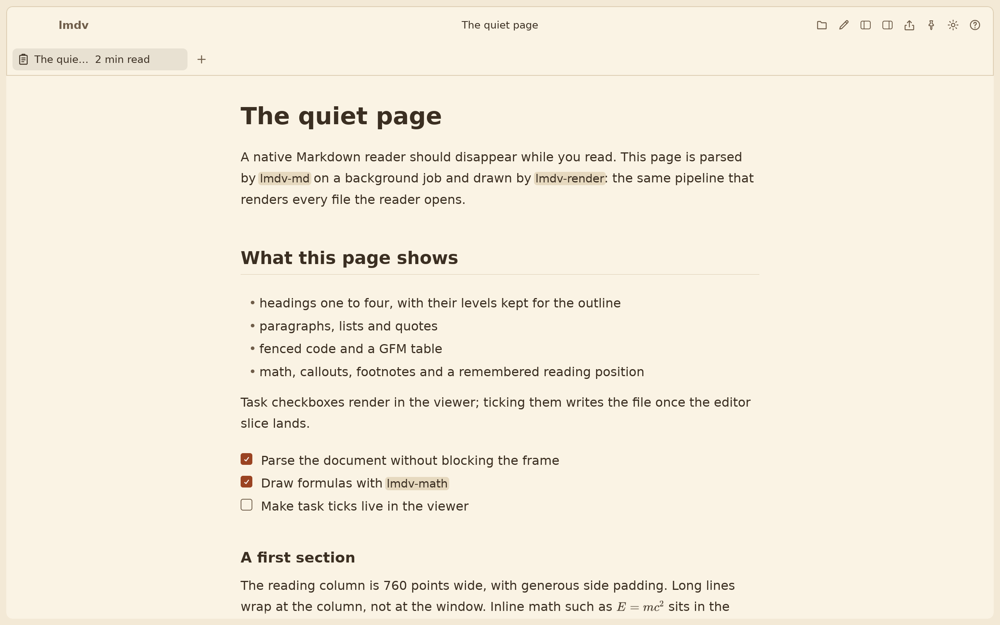

# lmdv

A native, Linux-first Markdown viewer and editor written in Rust with
[Rune](https://github.com/anomalyco/rune). GPU-rendered, with no webview.



**Latest release: v0.11.0** ·
[Download](https://github.com/LeandroMarceddu/lmdv-rs/releases/latest) ·
[Website](https://leandromarceddu.github.io/lmdv-rs/)

Linux is the primary, daily-use target: Wayland and X11, with the native
window frame. Windows builds and ships an installer; its runtime integration is still
checked by hand each release. macOS is not supported yet.

## What it does

- Opens `.md` files by double-click, drag-and-drop, command line, or the
  folder browser.
- Reads GitHub-flavored Markdown: tables, task lists, footnotes, callouts,
  front matter, syntax-highlighted code, Mermaid diagrams, math, images and
  video/audio (external player on Linux).
- Remembers reading positions, recent files, themes and text settings.
- Edits with a source editor and live preview: explicit save, crash-recovery
  drafts, file watching and conflict guards.
- Finds and replaces, with a command palette, outline, folder search, table
  preview and filtering.
- Exports self-contained HTML, DOCX and PDF, prints, and copies rich text.
- Speaks six interface languages, exposes an accessible tree, and ships four
  themes: light, sepia, dark and black.
- Works offline. No account, ads, telemetry or runtime network calls.

## Install

Download the latest release:

| Platform | Assets |
|---|---|
| Linux | `lmdv-0.11.0-x86_64.AppImage` or the raw `lmdv-0.11.0-x86_64` binary |
| Windows | `lmdv-0.11.0-installer.exe` or the raw `lmdv-0.11.0-windows-x86_64.exe` |

```bash
chmod +x lmdv-0.11.0-x86_64.AppImage
./lmdv-0.11.0-x86_64.AppImage path/to/file.md
```

Every release publishes `SHA256SUMS`, a detached `SHA256SUMS.asc` signature
and the public key. Verify a download with:

```bash
gpg --import lmdv-release-key.asc
gpg --verify SHA256SUMS.asc SHA256SUMS
sha256sum -c SHA256SUMS --ignore-missing
```

## Build from source

Rune pins Rust **1.99.1**. On CachyOS/Arch:

```bash
sudo pacman -S --needed libxkbcommon libxkbcommon-x11 wayland mesa-vulkan-drivers
rustup toolchain install 1.99.1
rustup component add rustfmt clippy --toolchain 1.99.1
```

```bash
cargo build --release -p lmdv
target/release/lmdv path/to/file.md
```

The CLI is `lmdv [--new-window] [file] [--line N]` (also `-l N`, `--line=N`,
`--`). A second launch opens the file in the running instance.

## Make it your Markdown handler

`scripts/install-md-handler.sh` registers the current build as your per-user
handler. It installs a stable launcher that follows whichever of
`target/debug/lmdv` or `target/release/lmdv` is newer, so rebuilding needs no
reinstall.

```bash
./scripts/install-md-handler.sh --dev        # prefer target/debug
./scripts/install-md-handler.sh --release    # prefer target/release
./scripts/install-md-handler.sh              # newest of the two
./scripts/install-md-handler.sh --uninstall  # restore the previous handler
```

Useful flags: `--binary PATH`, `--no-wrapper`, `--no-mime`, `--dry-run`,
`--purge`, `--force`, `--help`. If the handler does not appear, run
`update-desktop-database ~/.local/share/applications`, then
`gio open file.md`; on Plasma, log out/in or run `kbuildsycoca6`. See
[`docs/LINUX_INTEGRATION.md`](docs/LINUX_INTEGRATION.md) for the full test
plan.

## Limits

- Windows runtime checks (single instance, default handler, open/reveal,
  install/uninstall) are still manual; the build is compile-checked and
  installer-built, not yet claimed as fully verified.
- Multi-cursor is not implemented; `Ctrl+D` selects the next occurrence.
- Inline SVG is parsed and its links work, but vector shapes are not drawn
  yet.
- A few Rune-kit accessibility and localization gaps remain around pane
  grips and the tab strip.

## Development

- Current state and known issues: [`docs/STATUS.md`](docs/STATUS.md)
- Authoritative 342-row behavior spec: [`docs/BEHAVIOR_SPEC.md`](docs/BEHAVIOR_SPEC.md)
- Design and ownership: [`docs/ARCHITECTURE.md`](docs/ARCHITECTURE.md)
- Fixtures, scenes and gates: [`docs/TESTING.md`](docs/TESTING.md)
- Decisions and risks: [`docs/DECISIONS.md`](docs/DECISIONS.md),
  [`docs/RISKS_AND_SPIKES.md`](docs/RISKS_AND_SPIKES.md)
- Agent/contributor rules: [`AGENTS.md`](AGENTS.md)

CI runs the full workspace gate on Linux for every push to `main` and every
pull request; Windows is compile-checked on `windows-latest`. Releases are
tag-driven through
[`.github/workflows/release.yml`](.github/workflows/release.yml).

## License and provenance

MIT. The vendored Rune workspace keeps its own MIT license in
[`vendor/rune/`](vendor/rune/). Inspired by Leggimi.
